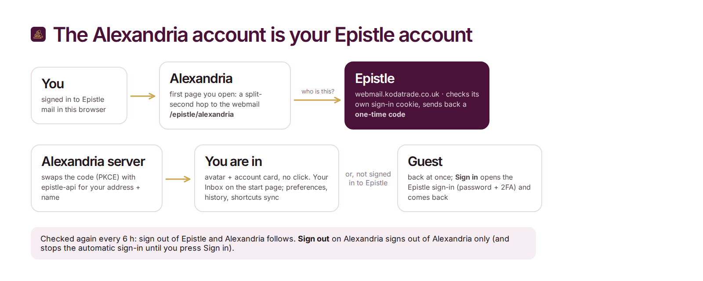

<p align="center"></p>

# Alexandria

**Alexandria** is Martynas's own private search engine, named after the ancient library that tried to hold everything ever written. It will run at **https://alexandria.epistle.email** (the old name, search.jack-sally.com, redirects there).
It asks Google, Brave, DuckDuckGo, Wikipedia and 70+ other engines at once, merges the answers into one clean
list, and none of them ever sees who searched. No ads, no tracking, no profile.

Under the hood it is a fork of [SearXNG](https://github.com/searxng/searxng) (AGPL-3.0) with its own look, a start
page full of widgets, and an app launcher for the rest of the self-hosted services. It is a sibling of
[Epistle](https://www.epistle.email): Google colours by day, Epistle's deep plum by night.

<p align="center"></p>

## What's different from stock SearXNG

| | |
|---|---|
| **Look** | Google layout and blue buttons / links, the name in Epistle's colours (see Logo), Inter for everything else (bundled, no Google Fonts call). Every result, the knowledge panel and the suggestions sit on their own card. Dark mode puts the cards on Epistle's deep plum; phones in light mode get a plum wash that fades out. Category tabs use Epistle-style glyphs in Epistle's folder colours (guitar for Music, scroll for News, amphora for Files…); Preferences is Epistle's sliders. Phones keep the name on top and a pill search box with a dropdown. |
| **Logo** | The name alone, lowercase **alexandria** in DM Serif Display (bundled, OFL), no icon beside it (picked 2026-10-25). On the start page photo it's a gold → rose gradient with a soft shadow; on results, preferences and history it's the plum → wax red → gold gradient (on a light plate in dark mode). The three scrolls on a gold shelf (Epistle's Archive glyph) are the favicon / app icon only. Sources in [`brand/`](brand/). |
| **Results backgrounds** | Library things behind the results, a different one of five at every search / refresh: a quiet constellation of line icons (books, ladders, quills, shelves, scrolls, columns, lamps…) joined by threads, the same in colour, endpapers (a slowly panning icon pattern), bookshelf walls with a gold ladder, and coloured icons floating up. No colour wash behind any of them: the page stays plain, the icons carry the colour. Light and dark versions, a still frame for reduced motion. `client/simple/src/js/main/library.ts`, icons in `util/libraryIcons.ts`. |
| **Start page** | Greeting + clock, your own shortcut tiles, weather (follows your rough location from your IP until you pick a city), recent searches, quick category chips, and (signed in) your **Inbox**: unread count + the newest 3 unread letters, each opening in Epistle. A **Customize** button turns each one on or off. |
| **Photo of the day** | The start page always sits on a Bing photo of the day, a different one every time it opens (never the one you saw last): a pool of the last ~2 weeks of Bing's English markets plus every photo seen since (up to 60), fetched and cached on disk by this server (`/widgets/photo`), so the browser never talks to Bing. Credit bottom left (on phones under the cards). The page turns dark with glass cards on it; the name keeps its colours on a frosted plate. Pinned to the large viewport so Safari's toolbar never re-crops it. `client/simple/src/js/main/backdrop.ts`, `searx/home_widgets.py`. |
| **Search history** | `/history`: every search (up to 400) by day with times, a filter box, × to forget one, *Save my searches* (pause), *Clear all*. Link from the Recent searches card and the account menu. `client/simple/src/js/main/history.ts`. |
| **App launcher** | The 9-dot button top right: Mail (Epistle), Drive (Nextcloud), Bitwarden (vault.jack-sally.com), Docs (BookStack), Git (Forgejo), n8n, Maps, YouTube. Each tile wears the service's real logo (Simple Icons, vendored in `searx/templates/simple/elements/app_logos.html`). Edit the list in `searx/settings.yml` → `brand.custom.apps` (`logo:`, `badge:`, `icon:`, colours). |
| **Alexandria account** | Your **Epistle** account: signed in to Epistle mail in this browser = signed in here, with no click. Avatar + account card top right (*Manage your Epistle account*, *Sign out*); shortcuts, recent searches, weather city and widget switches follow you to every device. See [Alexandria account](#alexandria-account). |
| **Loading** | The compass needle (purple, gold north tip) swings round and settles while something loads: in the search button while the next page comes, in the weather card, and in place of SearXNG's spinner (infinite scroll, image viewer). `client/simple/src/js/util/loading.ts`. |
| **Less clutter** | No About link, no language / time / SafeSearch row on results (the defaults come from Preferences). |
| **Little things** | `/` focuses the search box anywhere, a copy-link button on every result, a calmer phone layout. |
| **Privacy kept** | Shortcuts, history and your city live in *your browser's* localStorage only. Weather goes browser → Alexandria → [Open-Meteo](https://open-meteo.com) (no key, no account). For *near you*, Alexandria asks [ipwho.is](https://ipwho.is) (fallback ip-api.com) where your IP is, cached 6 h; on the VPN it sees a private address and uses the server's own IP instead. |

## How a search works

<p align="center"></p>

## Use it

**Make it Brave's default search engine**

1. Open `brave://settings/searchEngines` → **Site search** → **Add**.
2. Name `Alexandria`, shortcut `a`, URL `https://alexandria.epistle.email/search?q=%s` → **Add**.
3. On the new row, **⋮** → **Make default**. Address-bar suggestions come along automatically.

Firefox / Chrome: visit the site once, then pick *Alexandria* in the browser's search settings (it announces itself
via OpenSearch).

**Choose your sources:** Preferences → **Engines**: tick the engines you want per category, then **Save**. That's
stored in a cookie for this browser. To copy the same setup to your phone, use the link under Preferences →
**Cookies**. Instance-wide defaults go in `settings.yml` (`engines:` → `disabled: true|false`).

**Search shortcuts (bangs):** `!g rust` = Google only, `!w` Wikipedia, `!yt` YouTube, `!gh` GitHub, `:en` English results,
`!!g` jumps straight to Google. The full list is in Preferences → Engines.

## Repo layout

| Path | What |
|---|---|
| `client/simple/src/less/pretty.less` | **The Alexandria skin.** All the styling, loaded last over upstream's theme. |
| `client/simple/src/js/main/home.ts` | Start page widgets. `extras.ts`: launcher, `/` hotkey, copy link, history. `util/homeStore.ts`: localStorage. |
| `client/simple/src/fonts/` | Inter, variable (OFL). |
| `searx/templates/simple/` | `index.html` (start page), `elements/apps.html` (launcher), `elements/category_icons.html` (tab glyphs), `elements/sliders_icon.html` (Preferences), `elements/brand_mark.html` (generated logo). |
| `searx/accounts.py` | The Alexandria account (= Epistle account): `/account/login`, `/account/callback`, `/account/logout`, `/account/data` (sync), the silent check. Template `elements/account.html`, sync `client/simple/src/js/util/accountSync.ts`. |
| `searx/home_widgets.py` | `/widgets/geocode`, `/widgets/weather`, `/widgets/locate` (IP → rough location): the server side of the weather widget. |
| `searx/settings.yml` | Defaults baked into the image: name *Alexandria*, PWA colours, the app launcher list. |
| `searx/static/themes/simple/` | **Built** theme (committed, like upstream). Never edit by hand, run the build. |
| `brand/` | Logo: `src/mark.mjs` (the drawing; `S1` three scrolls is the logo, `N2` needle = the loading spinner, `N1` the old star), `src/scrolls.mjs` (the Epistle glyph), `src/logo.mjs` (renders `logo/*` + the theme's favicon / app icons). |
| `deploy/` | `build-image.sh`, `alexandria.portainer.yml`, `settings.example.yml` for node2. |
| `docs/readme/` | These images. Sources in `docs/readme/src/`. |
| everything else | Upstream SearXNG, unchanged. |

## Run it locally

```bash
python3 -m venv .venv && .venv/bin/pip install -r requirements.txt -r requirements-server.txt
(cd client/simple && npm ci && npm run build)          # theme -> searx/static/themes/simple
cat > /tmp/alexandria.yml <<'EOF'
use_default_settings: true
general: {debug: true}
server: {secret_key: "dev-only", bind_address: "0.0.0.0", port: 8888, limiter: false}
search: {favicon_resolver: "duckduckgo"}
EOF
SEARXNG_SETTINGS_PATH=/tmp/alexandria.yml .venv/bin/python -m searx.webapp   # http://<host>:8888
```

After every `npm run build`, restart the server (it indexes the static files at start-up).
Checks: `cd client/simple && npx tsc --noEmit && npx biome lint && npx stylelint "src/less/*.less"`,
and `.venv/bin/python -m nose2 -s tests/unit` (needs `requirements-dev.txt`).

## How a change gets live

<p align="center"></p>

On **ar_admin@cloudrunner-node2**:

```bash
~/searxng/deploy/build-image.sh        # git pull + docker build -> alexandria:latest, alexandria:<sha>
```

Then Portainer → Stacks → **alexandria** → *Pull and redeploy*. It is a **Git stack** (repo
`https://git.jack-sally.com/Martynas-Cloud/searxng.git`, ref `refs/heads/master`, compose path
`deploy/alexandria.portainer.yml`); the image is local (`pull_policy: never`), so always build first. No environment
variables: the container writes its own `settings.yml` (random `secret_key`, `use_default_settings: true`) into the
`alexandria-config` volume on first start; overrides are optional (`deploy/settings.example.yml`).
The reverse proxy maps `alexandria.epistle.email` → `192.168.178.27:48777` (cert `/etc/letsencrypt/live/epistle-domains/`, Cloudflare DNS record grey-cloud; `search.jack-sally.com` 301s there) (not hosted yet, 2026-10-24: the
stack is ready, the first deploy is still to do; see BookStack → Self Hosting → Alexandria → *deploy + update*).

## Re-render the logo and the README art

```bash
PW=<path to playwright/index.mjs> node brand/src/logo.mjs            # logo + favicon + PWA icons, then rebuild the theme
# dev server started with ALEXANDRIA_EPISTLE_URL=off (no silent sign-in hop while shooting)
PW=... ALEXANDRIA_URL=http://127.0.0.1:5173 node docs/readme/src/shots.mjs   # fresh screenshots (instance running)
PW=... node docs/readme/src/render.mjs                                # banner, diagrams, collage
```

## Alexandria account

<p align="center"></p>

There is no separate account: the Alexandria account **is the Epistle mailbox** (Martynas, 2026-10-24). How it works:
like an OAuth code flow with PKCE, without client secrets, and nothing to set up in Epistle beyond its images.

| Piece | Where |
|---|---|
| Alexandria | `searx/accounts.py`. A browser page load of `/`, `/search` or `/preferences` (`Sec-Fetch-Mode: navigate`) hops to `<ALEXANDRIA_EPISTLE_URL>/epistle/alexandria?prompt=none&…` when it's time: guests every 12 h, accounts every 6 h. **Sign in** = the same without `prompt=none` |
| Epistle webmail (sogo-client) | nginx hands `/epistle/alexandria` to epistle-api (its sign-in cookie only exists on `/epistle/` paths); the sign-in page goes back there afterwards (`?next=`) |
| epistle-api (epistle repo) | `server/internal/api/alexandria.go`: asks the webmail who the cookie belongs to, gives a 60 s one-time code to the allowlisted callback only, `POST /v1/alexandria/token` swaps it (+ PKCE verifier) for `{email, name}` |
| Stack env (Alexandria) | `ALEXANDRIA_EPISTLE_URL=https://epistle.email` (`off` = no accounts), `ALEXANDRIA_EPISTLE_API=http://host.docker.internal:28881` (epistle-api on node2). Both in `deploy/alexandria.portainer.yml`, nothing secret |
| Session | Signed cookie, 30 days, re-checked against Epistle every 6 h |
| Synced data | SQLite `alexandria-accounts.db` in the `alexandria-data` volume: one small JSON per mailbox (start page switches, search history, shortcuts, weather city; `/account/data`), the saved Preferences, and the inbox token |
| Preferences | Saved while signed in = stored for the account (`prefs_after`); another browser of the account takes them on at its next page load (`prefs_before`, into its cookies). *Reset defaults* forgets them everywhere |
| Mail card | At sign-in epistle-api also hands over an `inbox_token` (12 h, good for `GET /v1/alexandria/inbox` only: unread count + newest 3 unread, read-only, encrypted subjects never sent). It stays in the database, never in the browser; `/account/mail` asks with it (cached 60 s). The silent check signs in again before it runs out |

**Sign out** on Alexandria signs out of Alexandria only and stops the automatic sign-in until you press *Sign in*
again. Signing out of Epistle reaches Alexandria at its next check (within 6 h).

## Updating from upstream SearXNG

```bash
git remote add upstream https://github.com/searxng/searxng.git   # once
git fetch upstream && git merge upstream/master
(cd client/simple && npm ci && npm run build)    # always rebuild: the built theme conflicts, the sources rarely do
```

Alexandria keeps its changes in a few separate files (`pretty.less`, `home.ts`, `extras.ts`, `home_widgets.py`,
`apps.html`) so upstream merges stay small. If a merge conflicts in `searx/static/themes/simple/`, take either
side and rebuild.

**No symlinks.** Portainer refuses to clone a repo that contains one ("repository contains a symlink"). Upstream's
`utils/templates/etc/apache2 → httpd` is a real copy here. After every merge:
`git ls-files -s | awk '$1=="120000"'` must print nothing; replace anything it lists with a copy.

## Licence

AGPL-3.0-or-later, like SearXNG. The source is at https://git.jack-sally.com/Martynas-Cloud/searxng and linked
from every page footer. Upstream's own README is kept as [`README.rst`](README.rst).
