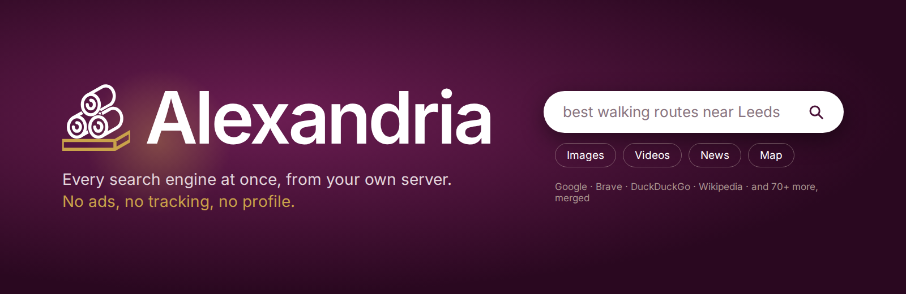
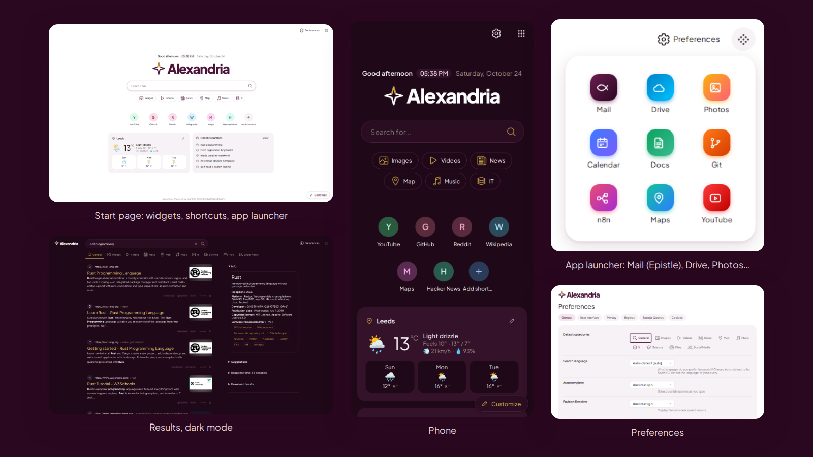
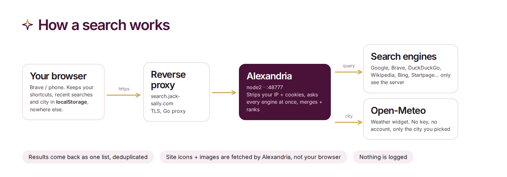
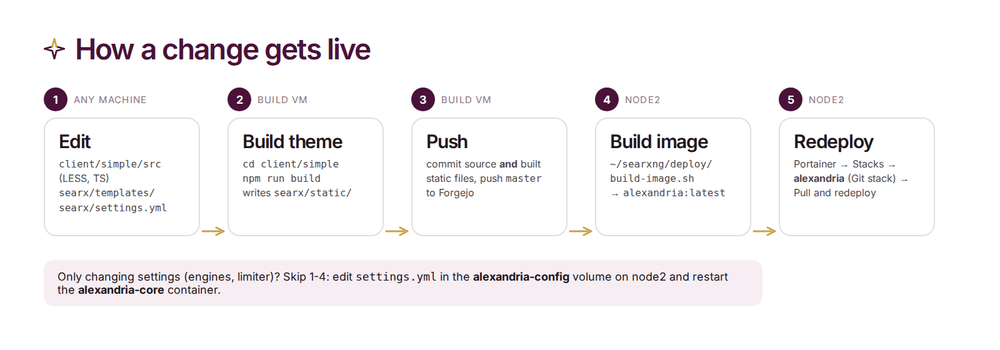

<p align="center"></p>

# Alexandria

**Alexandria** is Martynas's own private search engine, named after the ancient library that tried to hold everything ever written. It will run at **https://search.jack-sally.com**.
It asks Google, Brave, DuckDuckGo, Wikipedia and 70+ other engines at once, merges the answers into one clean
list, and none of them ever sees who searched. No ads, no tracking, no profile.

Under the hood it is a fork of [SearXNG](https://github.com/searxng/searxng) (AGPL-3.0) with its own look, a start
page full of widgets, and an app launcher for the rest of the self-hosted services. It is a sibling of
[Epistle](https://webmail.kodatrade.co.uk) and wears the same plum, on white, with a touch of gold.

<p align="center"></p>

## What's different from stock SearXNG

| | |
|---|---|
| **Look** | Google-clean layout: white + Epistle plum (dark mode is plum), Plus Jakarta Sans (bundled, no Google Fonts call), pill search box with a plum focus ring, sticky results header, site icons, knowledge panel as a card. On phones the search box stays a pill with a dropdown (stock SearXNG went full-screen white). |
| **Logo** | A four-point compass star, outline only, its north tip in gold: it points you the right way. Sources in [`brand/`](brand/). |
| **Start page** | Greeting + clock, your own shortcut tiles, weather, recent searches, a `!bang` cheat sheet, quick category chips. A **Customize** button turns each one on or off. |
| **App launcher** | The 9-dot button top right: Mail (Epistle), Drive, Photos and Calendar (Nextcloud), Docs (BookStack), Git (Forgejo), n8n, Maps, YouTube. Edit the list in `searx/settings.yml` → `brand.custom.apps`. |
| **Loading** | The compass needle from the logo swings round and settles while something loads: in the search button while the next page comes, in the weather card, and in place of SearXNG's spinner (infinite scroll, image viewer). `client/simple/src/js/util/loading.ts`. |
| **Little things** | `/` focuses the search box anywhere, a copy-link button on every result, a calmer phone layout. |
| **Privacy kept** | Shortcuts, history and your city live in *your browser's* localStorage only. Weather goes browser → Alexandria → [Open-Meteo](https://open-meteo.com) (no key, no account). |

## How a search works

<p align="center"></p>

## Use it

**Make it Brave's default search engine**

1. Open `brave://settings/searchEngines` → **Site search** → **Add**.
2. Name `Alexandria`, shortcut `a`, URL `https://search.jack-sally.com/search?q=%s` → **Add**.
3. On the new row, **⋮** → **Make default**. Address-bar suggestions come along automatically.

Firefox / Chrome: visit the site once, then pick *Alexandria* in the browser's search settings (it announces itself
via OpenSearch).

**Choose your sources:** Preferences → **Engines**: tick the engines you want per category, then **Save**. That's
stored in a cookie for this browser. To copy the same setup to your phone, use the link under Preferences →
**Cookies**. Instance-wide defaults go in `settings.yml` (`engines:` → `disabled: true|false`).

**Search shortcuts:** `!g rust` = Google only, `!w` Wikipedia, `!yt` YouTube, `!gh` GitHub, `:en` English results,
`!!g` jumps straight to Google. The full list is in Preferences → Engines.

## Repo layout

| Path | What |
|---|---|
| `client/simple/src/less/pretty.less` | **The Alexandria skin.** All the styling, loaded last over upstream's theme. |
| `client/simple/src/js/main/home.ts` | Start page widgets. `extras.ts`: launcher, `/` hotkey, copy link, history. `util/homeStore.ts`: localStorage. |
| `client/simple/src/fonts/` | Plus Jakarta Sans, variable (OFL). |
| `searx/templates/simple/` | `index.html` (start page), `elements/apps.html` (launcher), `elements/brand_mark.html` (generated logo). |
| `searx/home_widgets.py` | `/widgets/geocode` + `/widgets/weather`, the server side of the weather widget. |
| `searx/settings.yml` | Defaults baked into the image: name *Alexandria*, PWA colours, the app launcher list. |
| `searx/static/themes/simple/` | **Built** theme (committed, like upstream). Never edit by hand, run the build. |
| `brand/` | Logo: `src/mark.mjs` (the drawing; `N1` star is the logo, `N2` needle = the loading spinner), `src/logo.mjs` (renders `logo/*` + the theme's favicon / app icons). |
| `deploy/` | `build-image.sh`, `alexandria.portainer.yml`, `settings.example.yml` for node2. |
| `docs/readme/` | These images. Sources in `docs/readme/src/`. |
| everything else | Upstream SearXNG, unchanged. |

## Run it locally

```bash
python3 -m venv .venv && .venv/bin/pip install -r requirements.txt -r requirements-server.txt
(cd client/simple && npm ci && npm run build)          # theme -> searx/static/themes/simple
cat > /tmp/alexandria.yml <<'EOF'
use_default_settings: true
general: {debug: true}
server: {secret_key: "dev-only", bind_address: "0.0.0.0", port: 8888, limiter: false}
search: {favicon_resolver: "duckduckgo"}
EOF
SEARXNG_SETTINGS_PATH=/tmp/alexandria.yml .venv/bin/python -m searx.webapp   # http://<host>:8888
```

After every `npm run build`, restart the server (it indexes the static files at start-up).
Checks: `cd client/simple && npx tsc --noEmit && npx biome lint && npx stylelint "src/less/*.less"`,
and `.venv/bin/python -m nose2 -s tests/unit` (needs `requirements-dev.txt`).

## How a change gets live

<p align="center"></p>

On **ar_admin@cloudrunner-node2**:

```bash
~/searxng/deploy/build-image.sh        # git pull + docker build -> alexandria:latest, alexandria:<sha>
```

Then Portainer → Stacks → **alexandria** → *Update the stack* (stack file: `deploy/alexandria.portainer.yml`, image is
local, `pull_policy: never`). The live config is `/home/ar_admin/alexandria/config/settings.yml`; it must start with
`use_default_settings: true` so the Alexandria defaults in the image apply (see `deploy/settings.example.yml`).
The reverse proxy already maps `search.jack-sally.com` → `192.168.178.27:48777` (not hosted yet, 2026-10-24: the
stack is ready, the first deploy is still to do; see BookStack → Self Hosting → Alexandria → *deploy + update*).

## Re-render the logo and the README art

```bash
PW=<path to playwright/index.mjs> node brand/src/logo.mjs            # logo + favicon + PWA icons, then rebuild the theme
PW=... ALEXANDRIA_URL=http://127.0.0.1:5173 node docs/readme/src/shots.mjs   # fresh screenshots (instance running)
PW=... node docs/readme/src/render.mjs                                # banner, diagrams, collage
```

## Updating from upstream SearXNG

```bash
git remote add upstream https://github.com/searxng/searxng.git   # once
git fetch upstream && git merge upstream/master
(cd client/simple && npm ci && npm run build)    # always rebuild: the built theme conflicts, the sources rarely do
```

Alexandria keeps its changes in a few separate files (`pretty.less`, `home.ts`, `extras.ts`, `home_widgets.py`,
`apps.html`) so upstream merges stay small. If a merge conflicts in `searx/static/themes/simple/`, take either
side and rebuild.

## Licence

AGPL-3.0-or-later, like SearXNG. The source is at https://git.jack-sally.com/Martynas-Cloud/searxng and linked
from every page footer. Upstream's own README is kept as [`README.rst`](README.rst).
